<p align="center"><b>English</b> · <a href="README.pt.md">Português</a></p>

<p align="center">
  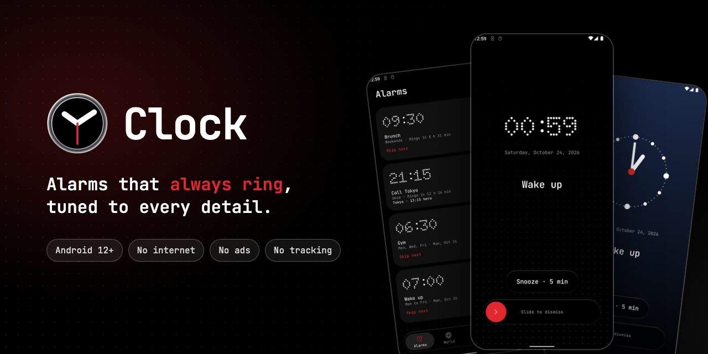
</p>

<p align="center">
  <a href="https://github.com/iM-lemoS/Clock/actions/workflows/ci.yml"></a>
  
  
  
  <a href="LICENSE"></a>
</p>

**Clock** is an open-source Android clock app (alarms, world clock, timers and stopwatch) built
around one promise: **alarms that always ring**, and that you can shape to the way you wake up.

Most clock apps give you a tone, a vibration switch and one snooze length. Clock lets you choose
how long each alarm rings and snoozes, pick a snooze length on the spot, design the screen you
wake up to, set alarms for specific dates or in another time zone, and get warned when a phone
setting could keep an alarm from ringing. No internet, no ads, no tracking.

https://github.com/user-attachments/assets/4e3541b6-3a30-4da8-b956-d2fcdec1641c

## Screenshots

<table>
  <tr>
    <td>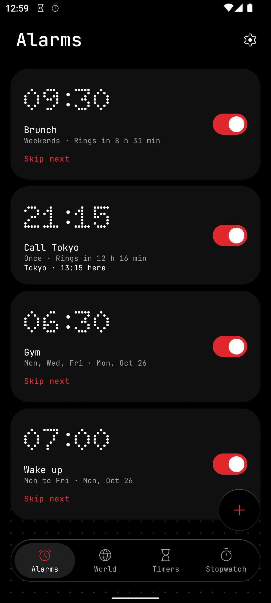</td>
    <td>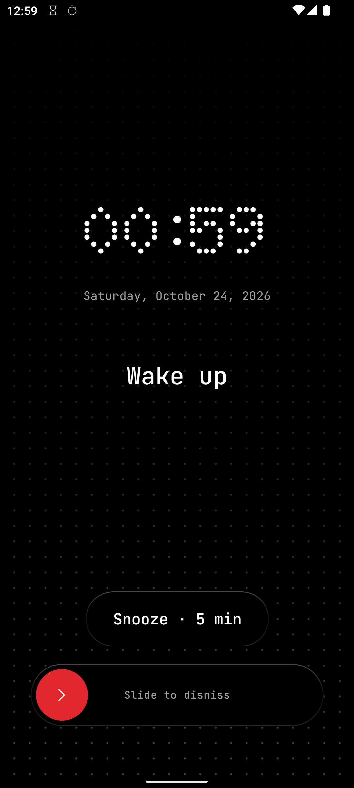</td>
    <td>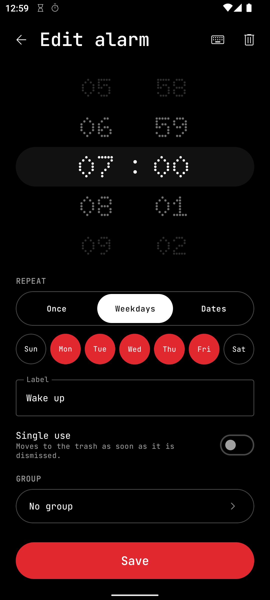</td>
    <td>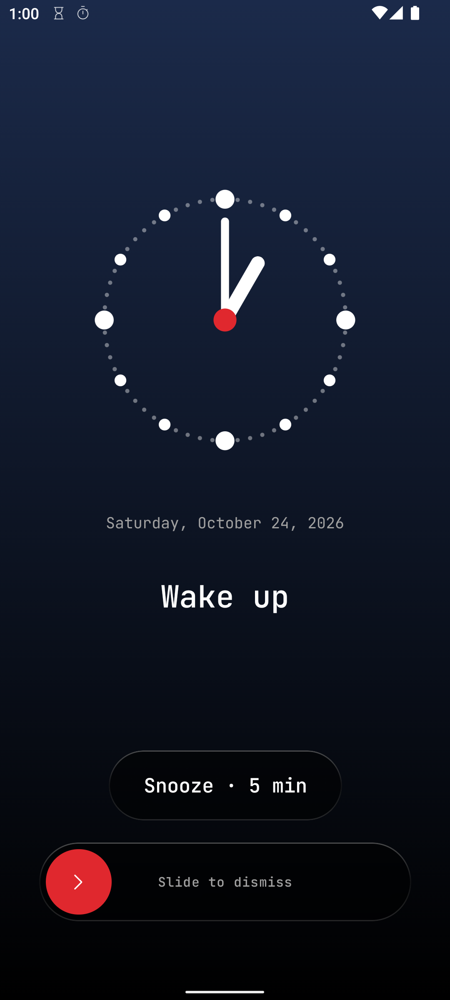</td>
    <td>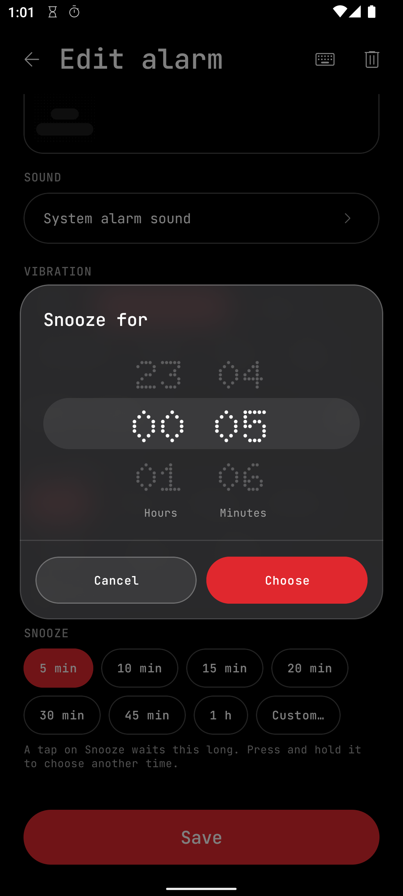</td>
  </tr>
  <tr>
    <td>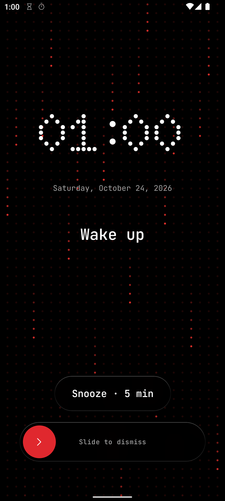</td>
    <td>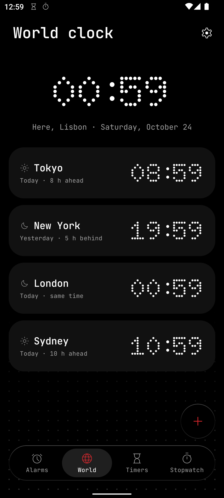</td>
    <td>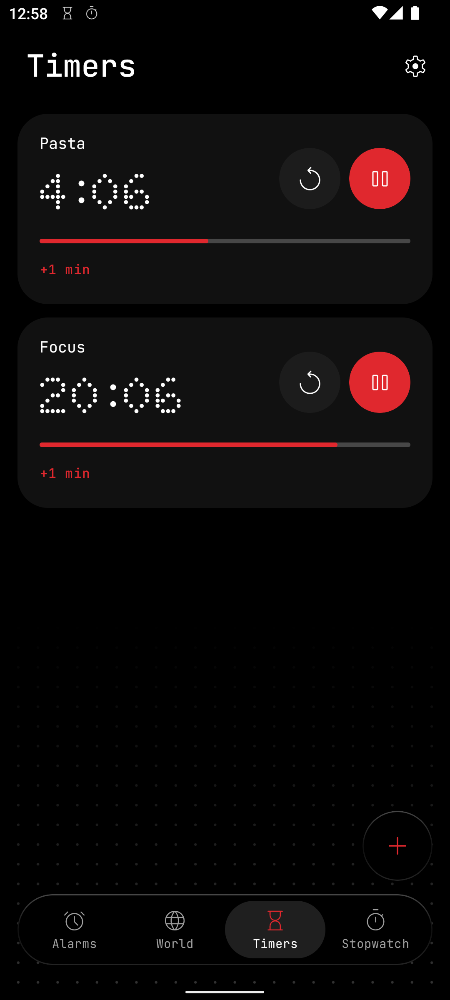</td>
    <td>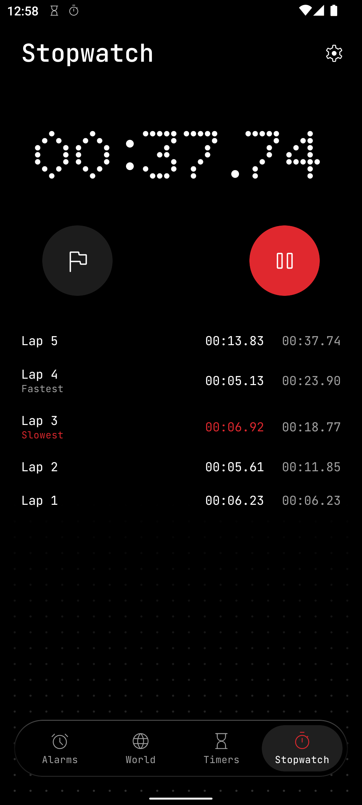</td>
    <td>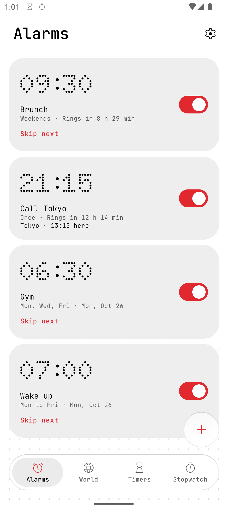</td>
  </tr>
</table>

## Features

**Alarms**
- Once, on chosen weekdays or on specific dates; single-use alarms that tidy themselves away.
- Skip the next occurrence; notices before an alarm (minutes, hours or days, several at once)
  with "Dismiss this one".
- Groups with a master switch, multi-select and batch edit, collision warnings, and a trash with
  undo.
- Type the time on the keyboard or spin the wheels.

**Sound and vibration**
- Any system tone or your own audio file, gradual volume, six vibration patterns or vibration
  synced to the sound.
- Ring duration per alarm (preset or custom, in hours and minutes), phone and Bluetooth output,
  a low-volume warning, and volume-down to silence a ringing alarm.

**The alarm screen**
- Tap Snooze, or hold it and slide over a dial to pick another length; your own snooze length
  appears on the dial too. Slide to dismiss.
- A library of layouts and an editor: six clock styles, seven fonts, weight, colours, date
  format, and solid, gradient, photo, silent video or animated backgrounds. Test any layout live.
- Rings over the lock screen, and even before the first unlock after a reboot.

**Time zones and more**
- A time zone per alarm, a manual app zone, and both times shown side by side.
- **World clock**; **timers** (several at once, live notifications, full screen when they end,
  +1 min); a **stopwatch** with laps.

**Design**
- Black and white with one accent colour (five presets or any colour you like), dot-matrix digits,
  light and dark themes, and "liquid glass" floating controls with a reduce-transparency option.
- Haptic feedback throughout. English and European Portuguese, following the phone's language.

## Alarms that always ring

- Every alarm uses `AlarmManager.setAlarmClock()`, the highest-priority alarm Android offers: it
  fires in Doze and shows in the status bar.
- A foreground service plays the sound and opens a full-screen alarm over the lock screen.
- Alarms are rescheduled after reboots (including before the first unlock), app updates, and time
  or time zone changes. A missed alarm is reported, never silently lost.
- The **Alarm reliability** screen checks notifications, full-screen alarms and battery limits,
  and gives step-by-step guidance for ColorOS (OPPO, realme, OnePlus), HyperOS/MIUI (Xiaomi,
  Redmi, POCO) and One UI (Samsung), with a generic fallback for every other phone.
- Tested on real phones (ColorOS 16 and One UI 8 on Android 16) and on an Android 12 emulator:
  locked screen, forced Doze, app killed, reboot, silent mode, Do Not Disturb, battery saver and
  Bluetooth.

## Privacy

Clock has **no internet permission**, no analytics, no ads and no accounts. Everything stays on
your phone. Tones, photos and videos come from the system pickers and are copied into the app, so
it needs no storage permission either. The build fails if any of these permissions ever sneaks
into the manifest.

| Permission | Why |
|---|---|
| `USE_EXACT_ALARM` (`SCHEDULE_EXACT_ALARM` on Android 12) | Ring at the exact minute |
| `USE_FULL_SCREEN_INTENT` | Show the alarm over the lock screen |
| `POST_NOTIFICATIONS` | Alarm, timer and notice notifications |
| `RECEIVE_BOOT_COMPLETED` | Reschedule alarms after a reboot |
| `FOREGROUND_SERVICE` (system-exempted, media playback) | Keep ringing while the alarm is on |
| `VIBRATE`, `WAKE_LOCK` | Vibrate and wake the screen |
| `POST_PROMOTED_NOTIFICATIONS` | Timers and the stopwatch as Live Updates (Android 16) |

## Download

Clock needs **Android 12 or newer**. Download `Clock-X.Y.Z.apk` from the
[latest release](https://github.com/iM-lemoS/Clock/releases/latest) and open it on your phone
(Android asks you to allow installs from your browser or file manager the first time).

Every release is signed with the same key. Its SHA-256 certificate fingerprint is
`03:5D:D5:5A:7C:59:84:20:3A:01:84:31:AA:7A:3C:F5:A3:00:C2:0A:09:81:F6:ED:61:85:A2:4A:5A:3D:FB:58`.

## Building from source

Requirements: JDK 17 or newer (Android Studio's bundled JBR works) and the Android SDK with
platform 37.

```sh
./gradlew assembleDebug        # app/build/outputs/apk/debug/app-debug.apk
./gradlew installDebug         # install on a connected device
./gradlew testDebugUnitTest :core:scheduling:test lintDebug
```

Release builds are signed only when a local `keystore.properties` exists; see
[`docs/RELEASING.md`](docs/RELEASING.md).

## Contributing

Bug reports, translations and pull requests are welcome. Please read
[`CONTRIBUTING.md`](CONTRIBUTING.md) first. If an alarm ever fails to ring, open an issue with
your phone model and Android version: that is the most valuable report there is.

Security issues: see [`SECURITY.md`](SECURITY.md).

## Project layout

```
app/                 Android app (Jetpack Compose, Hilt, Room, DataStore), organised by feature
core/scheduling/     pure Kotlin scheduling logic (next occurrence, time zones, DST) with unit tests
docs/                product plan (Portuguese), release notes and media
fastlane/            store listing in English and Portuguese
licenses/            licences of the bundled fonts and icons
```

The product plan, [`docs/PLANO.md`](docs/PLANO.md), is written in Portuguese. Changes are listed
in [`CHANGELOG.md`](CHANGELOG.md).

## Credits

- **Rafael Lemos**: idea, design and testing.
- **Claude** (Anthropic): code, as an AI pair programmer.

## Third-party assets

- Fonts, all under the SIL Open Font License 1.1 (`licenses/fonts`), bundled unmodified:
  [Doto](https://github.com/oliverlalan/Doto), [JetBrains Mono](https://github.com/JetBrains/JetBrainsMono),
  and for alarm screen clocks [Outfit](https://github.com/Outfitio/Outfit-Fonts),
  [Playfair Display](https://github.com/clauseggers/Playfair-Display),
  [Orbitron](https://github.com/theleagueof/orbitron),
  [Big Shoulders Display](https://github.com/xotypeco/big_shoulders) and
  [Comfortaa](https://github.com/alexeiva/comfortaa).
- [Material Symbols](https://github.com/google/material-design-icons): Apache License 2.0
  (`licenses/icons`).
- The tour video's soundtrack is built from Apple Loops, used under Apple's licence for original
  compositions.

## License

Clock is free software under the [GNU General Public License v3.0](LICENSE): you can use,
study, share and modify it, and any distributed modified version must stay open under the same
licence. Bundled fonts and icons keep their own licences (`licenses/`).
