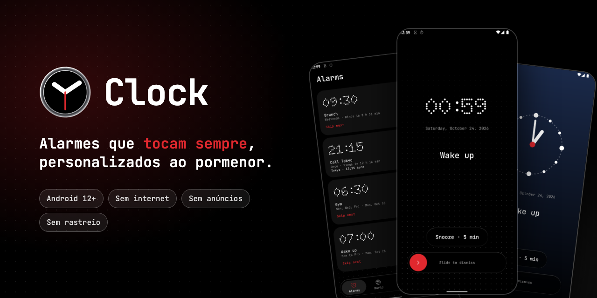

<p align="center"><a href="README.md">English</a> · <b>Português</b></p>

<p align="center">
  
</p>

<p align="center">
  <a href="https://github.com/iM-lemoS/Clock/actions/workflows/ci.yml"></a>
  
  
  
  <a href="LICENSE"></a>
</p>

O **Clock** é uma app de relógio open source para Android (alarmes, relógio mundial, timers e
cronómetro) construída à volta de uma promessa: **alarmes que tocam sempre**, e que moldas à tua
maneira de acordar.

A maioria das apps de relógio dá-te um toque, um interruptor de vibração e uma única duração de
snooze. No Clock escolhes quanto tempo cada alarme toca e adia, escolhes o snooze na hora, desenhas
o ecrã com que acordas, crias alarmes para datas específicas ou noutro fuso horário, e és avisado
quando uma definição do telemóvel pode impedir um alarme de tocar. Sem internet, sem anúncios, sem
rastreio.

https://github.com/user-attachments/assets/4e3541b6-3a30-4da8-b956-d2fcdec1641c

## Capturas de ecrã

<table>
  <tr>
    <td></td>
    <td></td>
    <td></td>
    <td></td>
    <td></td>
  </tr>
  <tr>
    <td></td>
    <td></td>
    <td></td>
    <td></td>
    <td></td>
  </tr>
</table>

## Funcionalidades

**Alarmes**
- Uma vez, em dias da semana à escolha ou em datas específicas; alarmes de utilização única que se
  arrumam sozinhos.
- Saltar a próxima ocorrência; avisos antes do alarme (minutos, horas ou dias, vários ao mesmo
  tempo) com "Desligar este".
- Grupos com interruptor mestre, seleção múltipla e edição em lote, aviso de colisões e caixote do
  lixo com anular.
- Duplica um alarme para começares um novo com todas as definições dele.
- Escreve a hora no teclado ou roda as rodas.

**Som e vibração**
- Qualquer toque do sistema ou um ficheiro de áudio teu, volume gradual, seis padrões de vibração
  ou vibração sincronizada com o som.
- Duração do toque por alarme (predefinida ou personalizada, em horas e minutos), saída no
  telemóvel e no Bluetooth, aviso de volume baixo, e o botão de baixar o volume silencia o alarme.

**O ecrã do alarme**
- Toca em Snooze, ou mantém premido e desliza sobre uma roda para escolher outra duração; o teu
  snooze personalizado também aparece na roda. Desliza para desligar.
- Uma biblioteca de layouts e um editor: seis estilos de relógio, sete letras, espessura, cores,
  formato da data, e fundos de cor sólida, gradiente, foto, vídeo sem som ou animados. Testa
  qualquer layout ao vivo.
- Toca por cima do ecrã de bloqueio, e até antes do primeiro desbloqueio depois de reiniciar.

**Fusos horários e mais**
- Um fuso por alarme, um fuso manual para a app e as duas horas lado a lado.
- **Relógio mundial**; **timers** (vários ao mesmo tempo, notificações ao vivo, ecrã inteiro
  quando acabam, +1 min); **cronómetro** com voltas.

**Design**
- Preto e branco com uma cor de destaque (cinco predefinidas ou a cor que quiseres), dígitos em
  matriz de pontos, temas claro e escuro, e controlos flutuantes em "liquid glass" com opção de
  reduzir a transparência.
- Resposta háptica em toda a app. Inglês e português europeu, a seguir o idioma do telemóvel.

## Alarmes que tocam sempre

- Cada alarme usa `AlarmManager.setAlarmClock()`, o alarme de maior prioridade do Android: dispara
  em Doze e aparece na barra de estado.
- Um serviço em primeiro plano toca o som e abre o alarme em ecrã inteiro por cima do ecrã de
  bloqueio.
- Os alarmes são reagendados depois de reiniciar (mesmo antes do primeiro desbloqueio), de
  atualizações da app e de mudanças de hora ou de fuso. Um alarme perdido é sempre comunicado,
  nunca desaparece em silêncio.
- O ecrã **Fiabilidade dos alarmes** verifica as notificações, o ecrã inteiro e os limites de
  bateria, e dá-te os passos para ColorOS (OPPO, realme, OnePlus), HyperOS/MIUI (Xiaomi, Redmi,
  POCO) e One UI (Samsung), com uma alternativa genérica para todos os outros telemóveis.
- Testado em telemóveis reais (ColorOS 16 e One UI 8 com Android 16) e num emulador com Android 12:
  ecrã bloqueado, Doze forçado, app fechada à força, reinício, modo silêncio, Não incomodar,
  poupança de energia e Bluetooth.

## Privacidade

O Clock **não tem permissão de internet**, nem analytics, nem anúncios, nem contas. Tudo fica no
teu telemóvel. Toques, fotos e vídeos vêm dos seletores do sistema e são copiados para dentro da
app, por isso também não precisa de permissões de armazenamento. A compilação falha se alguma
destas permissões aparecer no manifesto.

| Permissão | Para quê |
|---|---|
| `USE_EXACT_ALARM` (`SCHEDULE_EXACT_ALARM` no Android 12) | Tocar no minuto certo |
| `USE_FULL_SCREEN_INTENT` | Mostrar o alarme por cima do ecrã de bloqueio |
| `POST_NOTIFICATIONS` | Notificações de alarmes, timers e avisos |
| `RECEIVE_BOOT_COMPLETED` | Reagendar os alarmes depois de reiniciar |
| `FOREGROUND_SERVICE` (isento pelo sistema, reprodução de multimédia) | Continuar a tocar enquanto o alarme está ativo |
| `VIBRATE`, `WAKE_LOCK` | Vibrar e acordar o ecrã |
| `POST_PROMOTED_NOTIFICATIONS` | Timers e cronómetro como Live Updates (Android 16) |

## Transferir

O Clock precisa de **Android 12 ou mais recente**. Transfere o `Clock-X.Y.Z.apk` da
[última release](https://github.com/iM-lemoS/Clock/releases/latest) e abre-o no telemóvel (da
primeira vez, o Android pede-te para permitires instalações a partir do browser ou do gestor de
ficheiros).

Todas as releases são assinadas com a mesma chave. A impressão digital SHA-256 do certificado é
`03:5D:D5:5A:7C:59:84:20:3A:01:84:31:AA:7A:3C:F5:A3:00:C2:0A:09:81:F6:ED:61:85:A2:4A:5A:3D:FB:58`.

## Compilar a partir do código

Requisitos: JDK 17 ou mais recente (o JBR que vem com o Android Studio serve) e o Android SDK com a
plataforma 37.

```sh
./gradlew assembleDebug        # app/build/outputs/apk/debug/app-debug.apk
./gradlew installDebug         # instala num dispositivo ligado
./gradlew testDebugUnitTest :core:scheduling:test lintDebug
```

As builds de release só são assinadas quando existe um `keystore.properties` local; vê
[`docs/RELEASING.md`](docs/RELEASING.md) (em inglês).

## Contribuir

Relatórios de bugs, traduções e pull requests são bem-vindos. Lê primeiro o
[`CONTRIBUTING.pt.md`](CONTRIBUTING.pt.md). Se algum alarme não tocar, abre uma issue com o modelo
do telemóvel e a versão do Android: é o relatório mais valioso que nos podes dar. Podes escrever
em português.

Problemas de segurança: vê o [`SECURITY.md`](SECURITY.md).

## Organização do projeto

```
app/                 app Android (Jetpack Compose, Hilt, Room, DataStore), organizada por funcionalidade
core/scheduling/     lógica de agendamento em Kotlin puro (próxima ocorrência, fusos, hora de verão) com testes
docs/                plano do produto, notas de release e multimédia
fastlane/            descrição para lojas em inglês e português
licenses/            licenças das letras e ícones incluídos
```

O plano do produto, [`docs/PLANO.md`](docs/PLANO.md), está em português. As alterações estão no
[`CHANGELOG.md`](CHANGELOG.md). O código, os comentários e a documentação técnica estão em inglês.

## Créditos

- **Rafael Lemos**: ideia, design e testes.
- **Claude** (Anthropic): código, como programador de IA em par.

## Recursos de terceiros

- Letras, todas sob a SIL Open Font License 1.1 (`licenses/fonts`), incluídas sem alterações:
  [Doto](https://github.com/oliverlalan/Doto), [JetBrains Mono](https://github.com/JetBrains/JetBrainsMono),
  e para os relógios do ecrã do alarme [Outfit](https://github.com/Outfitio/Outfit-Fonts),
  [Playfair Display](https://github.com/clauseggers/Playfair-Display),
  [Orbitron](https://github.com/theleagueof/orbitron),
  [Big Shoulders Display](https://github.com/xotypeco/big_shoulders) e
  [Comfortaa](https://github.com/alexeiva/comfortaa).
- [Material Symbols](https://github.com/google/material-design-icons): Apache License 2.0
  (`licenses/icons`).
- A banda sonora do vídeo de apresentação é feita com Apple Loops, usados ao abrigo da licença da
  Apple para composições originais.

## Licença

O Clock é software livre sob a [GNU General Public License v3.0](LICENSE): podes usá-lo,
estudá-lo, partilhá-lo e modificá-lo, e qualquer versão modificada que seja distribuída tem de
continuar aberta com a mesma licença. As letras e os ícones incluídos mantêm as suas licenças
(`licenses/`).
